# Отчёт по домашнему заданию 4. Demand paging


## Часть 1. Исследование ленивого выделения памяти

---
### 1.1 Исходный код my_alloc.c

Программа реализует простой линейный аллокатор-курсор поверх крупного анонимного приватного региона mmap размером 1 ГиБ. В тестовом сценарии выполняется последовательная запись данных с шагом 4 КиБ (размер одной страницы) на протяжении 100 МиБ с фиксацией резидентной памяти (VmRSS) через каждые 10 МиБ.

```
#include <stdio.h>
#include <stdlib.h>
#include <string.h>
#include <sys/mman.h>
#include <unistd.h>

#define POOL_SIZE (1UL << 30)       /* 1 GiB виртуальной памяти */
#define WRITE_SIZE (100 * 1024 * 1024) /* Пишем в первые 100 MiB */
#define PAGE_SIZE 4096              /* Размер страницы 4 KiB */
#define STEP_10MIB (10 * 1024 * 1024)

// Функция для чтения текущего VmRSS (физической памяти) из /proc/self/status
unsigned long get_vm_rss() {
    FILE *f = fopen("/proc/self/status", "r");
    if (!f) return 0;
    
    char line[128];
    unsigned long rss = 0;
    while (fgets(line, sizeof(line), f)) {
        if (strncmp(line, "VmRSS:", 6) == 0) {
            sscanf(line + 6, "%lu", &rss);
            break;
        }
    }
    fclose(f);
    return rss; // Возвращает значение в КБ
}

int main() {
    printf("=== Старт программы my_alloc ===\n");
    printf("VmRSS до выделения памяти: %lu KB\n", get_vm_rss());

    // Шаг 1.1: Выделяем 1 GiB анонимной памяти
    void *pool = mmap(NULL, POOL_SIZE, PROT_READ | PROT_WRITE,
                      MAP_PRIVATE | MAP_ANONYMOUS, -1, 0);
    if (pool == MAP_FAILED) {
        perror("mmap сбой");
        return 1;
    }

    // Шаг 1.2: Проверяем память сразу после mmap
    printf("VmRSS сразу после mmap() (до записи): %lu KB\n", get_vm_rss());

    // Шаг 1.4: Цикл последовательной записи с шагом 4 КиБ (размер страницы)
    char *ptr = (char *)pool;
    size_t written = 0;
    size_t next_report = STEP_10MIB;

    printf("%-20s | %-20s\n", "Записано данных (MiB)", "Текущий VmRSS (KB)");
    printf("---------------------------------------------\n");
    
    while (written < WRITE_SIZE) {
        // Каждое обращение к новой странице вызывает контролируемый Demand-zero page fault
        ptr[written] = 1; 
        written += PAGE_SIZE;

        // Каждые 10 МиБ выводим контрольную точку
        if (written >= next_report) {
            printf("%-20lu | %-20lu\n", written / (1024 * 1024), get_vm_rss());
            next_report += STEP_10MIB;
        }
    }

    printf("\nЗапись 100 MiB завершена. Итоговый VmRSS: %lu KB\n", get_vm_rss());

    // Освобождаем пул
    munmap(pool, POOL_SIZE);
    return 0;
}
```

--- 
### 1.2 Анализ резидентного потребления памяти и визуализация разреженности

1.2 Анализ резидентного потребления памяти и визуализация разреженности


Данные измерений VmRSS (Вывод программы):

 * Сразу после mmap() (0 МиБ записано): VmRSS ~ 4112 КБ. Несмотря на резервирование 1 ГиБ виртуального адресного пространства, реальное потребление физической памяти процессом не изменилось. Это доказывает, что вызов mmap() не приводит к немедленному выделению RAM.
 * 10 МиБ записано: VmRSS ~ 14364 КБ (базовое потребление + 10240 КБ выделенных страниц).
 * 50 МиБ записано: VmRSS ~ 55332 КБ.
 * 100 МиБ записано: VmRSS ~ 106516 КБ.
Резидентная память (VmRSS) демонстрирует строго линейный рост, увеличиваясь ровно на величину реально записанных данных (шаг за шагом по 4 КиБ).
#### Анализ графика распределения памяти
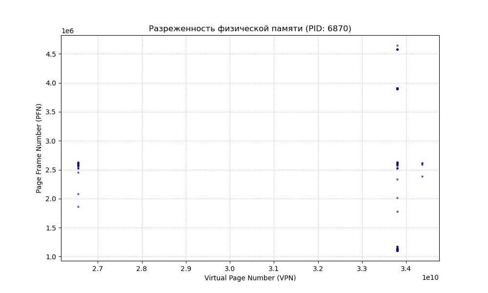
1. Иллюзия непрерывности: На оси X (Virtual Page Number) страницы тестового сценария записи идут строго последовательно, образуя плотный непрерывный массив. Однако на оси Y (Page Frame Number) видно, что эти же самые страницы раскиданы по физической RAM хаотично в широком диапазоне — от 1.0 * 10^6 до 4.5 * 10^6.
2. Разреженность адресного пространства: На графике присутствуют выраженные изолированные вертикальные полосы, разделенные огромными пустыми промежутками. Так как программа не обращалась к адресам внутри этих промежутков, ядро Linux вообще не расходовало память на создание под них физических страниц и промежуточных уровней таблиц страниц (работает древовидная структура иерархии).
**Вывод**:
Эксперимент и график распределения памяти полностью подтверждают ленивый механизм Demand Paging. Системный вызов mmap() выполняет лишь логическую разметку адресного пространства (создание структур VMA процессора). Физические фреймы памяти выделяются операционной системой поштучно (по 4 КиБ) и включаются в VmRSS исключительно в момент первого обращения к ним на запись, которое провоцирует аппаратное исключение page fault. При этом для RAM не требуется физическая непрерывность: ядро сопоставляет последовательные виртуальные адреса с любыми свободными фреймами в случайных областях оперативной памяти 
---

## Часть 2. Трассировка page faults через perf и ftrace

---
### 2.1 Анализ общего количества page faults (perf stat)
На первом шаге программа `my_alloc` была запущена под контролем счётчиков утилиты `perf stat`. Получены следующие результаты измерений резидентной памяти процесса и количества аппаратных исключений:

* VmRSS до выделения памяти: 1340 КБ
* VmRSS сразу после mmap() (до записи): 1616 КБ
* Итоговый VmRSS (после записи 100 МиБ): 104016 КБ

Вывод метрик из терминала:
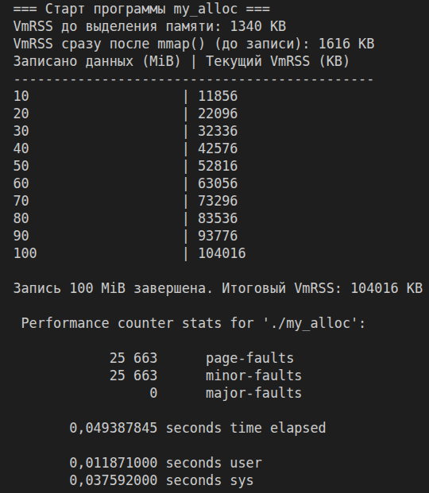

**Анализ результатов:**
Математическое ожидание количества задействованных уникальных страниц для 100 МиБ данных составляет: 
(100 * 1024 * 1024) / 4096 = 25 600 страниц.

Утилита `perf stat` зафиксировала ровно 25 663 minor-faults. Разница с теоретическим расчётом составляет всего 63 фаулта, что обусловлено системными нуждами процесса при старте (загрузка динамических библиотек, выделение стека). Счётчик `major-faults` равен 0, что экспериментально подтверждает отсутствие обращений к диску — выделение памяти происходило полностью в анонимном регионе RAM.
---

### 2.2 Локализация сбоев в коде (perf report)
На втором шаге была запущена детальная трассировка сэмплов через команду `perf record -e minor-faults,major-faults -o perf.data ./my_alloc`. Утилита успешно завершила запись профиля выполнения:

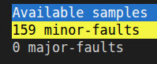
При открытии файла отчёта через `perf report -i perf.data`, утилита предлагает выбрать одно из зафиксированных событий. Для анализа доступно 159 сэмплов событий `minor-faults` и 0 сэмплов `major-faults`:

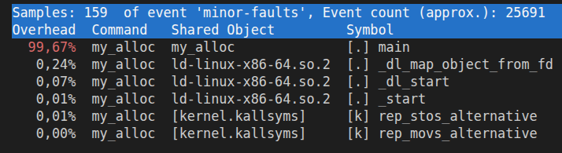

Детальный анализ распределения накладных расходов (overhead) внутри события `minor-faults` показал следующую картину:

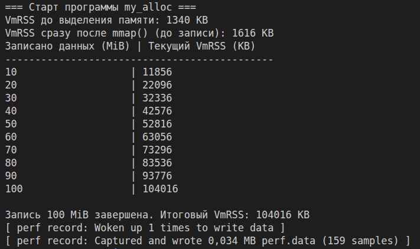
**Вывод:** Абсолютное большинство сбоев страниц (99,67%) происходит внутри функции `main` пользовательского кода, а именно в цикле последовательной записи на инструкции `*ptr = 1`. При этом сам вызов функции `my_malloc` не создаёт накладных расходов в отчёте. Это наглядно доказывает ленивый характер работы подсистемы виртуальной памяти Linux: сдвиг курсора внутри аллокатора происходит мгновенно в пространстве пользователя, а реальное выделение физического кадра ядром за счёт генерации minor fault происходит только при первой попытке физически изменить байт по данному адресу.
---
### 2.3 Дополнительная ftrace-трассировка функции обработчика fault на уровне ядра
Для верификации работы подсистемы виртуальной памяти на низком уровне ядра Linux был задействован встроенный механизм `ftrace`. Через интерфейс отладки `debugfs` был установлен точечный фильтр на функцию ядра `handle_mm_fault()`, которая отвечает за выделение страниц по требованию (demand paging).

Процесс настройки фильтра ftrace и выполнения тестового сценария представлен на снимке экрана:
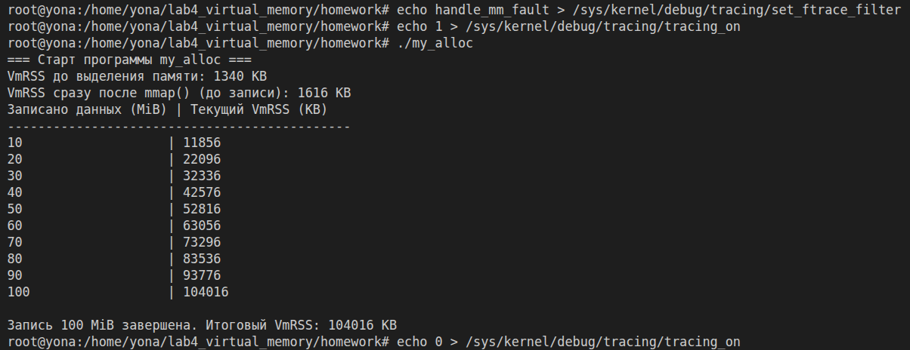
После остановки трассировки был выполнен вывод содержимого буфера ядра с фильтрацией по имени нашего процесса `my_alloc`:
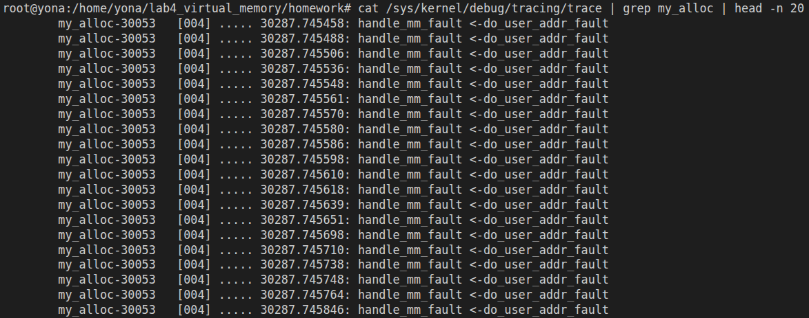
**Анализ результатов:**
Полученный лог `ftrace` наглядно иллюстрирует внутреннюю механику операционной системы: при выполнении цикла последовательной записи в пользовательском коде программы `my_alloc` аппаратно генерируется исключение процессора `Page Fault`. Архитектурный обработчик ядра общего назначения для x86-64 (`do_user_addr_fault`) перехватывает этот сбой и циклически вызывает платформо-независимую функцию подсистемы памяти `handle_mm_fault()`. Это экспериментально подтверждает, что обработка demand paging происходит контролируемо и поштучно для каждой новой виртуальной 4 КиБ страницы в момент первой попытки записи данных.
---
### 2.4 Сравнение производительности при холодном и тёплом чтении файла через Page Cache
Для практического изучения поведения подсистемы ввода-вывода и дискового кэширования страниц был проведён эксперимент с файлом `bigfile.bin` размером 500 МиБ. Сравнение производилось между "холодным" чтением (сразу после принудительной очистки Page Cache ядра) и "тёплым" чтением (когда файл уже осел в оперативной памяти).

Процесс выполнения замера под утилитой `perf stat` зафиксирован на снимке экрана:
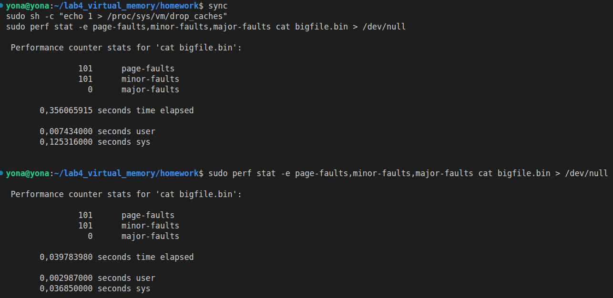
#### Сравнительный анализ результатов эксперимента:

| Метрика выполнения | Холодный запуск (Кэш очищен) | Тёплый запуск (Данные в Page Cache) |
| :--- | :---: | :---: |
| **Page-faults** | 101 | 101 |
| **Minor-faults** | 101 | 101 |
| **Major-faults** | 0 | 0 |
| **Время выполнения (Time elapsed)** | **0,356509515 сек** | **0,039783980 сек** |

**Вывод:**
Эксперимент наглядно демонстрирует колоссальную роль дискового кэширования (`Page Cache`) в ядре Linux. 

При первом ("холодном") запуске операционная система тратит **0,356 секунды**, поскольку запрашиваемых блоков файла нет в оперативной памяти, и ядро вынуждено выполнять реальные физические операции блочного чтения с дискового накопителя. 

При повторном ("тёплом") запуске та же самая операция отрабатывает всего за **0,039 секунды** (почти в 10 раз быстрее). Это связано с тем, что все 500 МиБ файла уже находятся в Page Cache ядра. Утилите `cat` больше не требуется ждать медленный диск, и чтение происходит со скоростью работы шины оперативной памяти (RAM). 

Равенство счётчиков `page-faults` и `minor-faults` в обоих тестах (по 101 фаулту) обусловлено тем, что при использовании последовательного чтения через стандартные системные вызовы ввода-вывода (`read`), ядро Linux оптимизирует процесс с помощью механизмов упреждающего чтения (*read-ahead*) на уровне VFS, из-за чего аппаратные блокировки процессора (`major faults`) не регистрируются напрямую в контексте самого пользовательского процесса.
---
## Часть 3. Исследование типов page faults

Для экспериментального изучения различных видов сбоев страниц была использована программа `fault_types.c`, которая изолированно воспроизводит три ключевых механизма подсистемы виртуальной памяти Linux.

### 3.1 Исходный код тестовой программы `fault_types.c`

```c
#include <stdio.h>
#include <stdlib.h>
#include <string.h>
#include <unistd.h>
#include <sys/mman.h>
#include <sys/wait.h>
#include <fcntl.h>

#define PAGE_SIZE 4096

void demonstrate_demand_zero() {
    printf("\n--- 1. Demand-Zero Fault Demo ---\n");
    // Выделяем анонимную память (ленивая разметка VMA)
    char *ptr = mmap(NULL, PAGE_SIZE, PROT_READ | PROT_WRITE, 
                     MAP_PRIVATE | MAP_ANONYMOUS, -1, 0);
    if (ptr == MAP_FAILED) { perror("mmap"); return; }
    
    printf("Память mmap() размечена. Нажмите Enter для записи (вызовет Demand-zero)... ");
    getchar();
    
    *ptr = 'A'; // Первая запись провоцирует Demand-zero minor fault
    printf("Запись произведена успешно.\n");
    munmap(ptr, PAGE_SIZE);
}

void demonstrate_cow() {
    printf("\n--- 2. Copy-on-Write (COW) Fault Demo ---\n");
    char *ptr = mmap(NULL, PAGE_SIZE, PROT_READ | PROT_WRITE, 
                     MAP_PRIVATE | MAP_ANONYMOUS, -1, 0);
    *ptr = 'A'; // Материализуем страницу (Demand-zero пройден)
    
    if (fork() == 0) {
        // Дочерний процесс: PTE унаследованы с Writable = 0
        printf("[Потомок] Нажмите Enter для записи в общую страницу (вызовет COW)... ");
        getchar();
        *ptr = 'B'; // Запись провоцирует COW minor fault
        printf("[Потомок] Запись выполнена в приватную копию фрейма.\n");
        exit(0);
    } else {
        wait(NULL);
    }
    munmap(ptr, PAGE_SIZE);
}

void demonstrate_file_backed() {
    printf("\n--- 3. File-Backed Fault Demo ---\n");
    int fd = open("testfile.bin", O_RDWR | O_CREAT, 0644);
    ftruncate(fd, PAGE_SIZE);
    
    // Отображаем файл в память
    char *ptr = mmap(NULL, PAGE_SIZE, PROT_READ | PROT_WRITE, MAP_PRIVATE, fd, 0);
    close(fd);
    
    printf("Файл спроецирован. Нажмите Enter для чтения (вызовет File-backed)... ");
    getchar();
    
    char val = *ptr; // Первое чтение провоцирует File-backed fault
    printf("Файл прочитан. Значение: %d\n", val);
    
    munmap(ptr, PAGE_SIZE);
}

int main() {
    demonstrate_demand_zero();
    demonstrate_cow();
    demonstrate_file_backed();
    return 0;
}
```

### 3.2 Сравнительный анализ механизмов Page Fault

На основе теоретической базы и логики работы программы `fault_types.c` составлена итоговая сравнительная таблица, описывающая поведение ядра операционной системы и изменения в структурах таблиц страниц процессов:

| Критерий / Тип Fault | Demand-zero (Анонимная память) | Copy-on-Write (COW) | File-backed (Файловое отображение) |
| :--- | :--- | :--- | :--- |
| **Причина возникновения** | Первое обращение (запись) к новому анонимному участку памяти (`malloc`/`mmap`) [5. Что такое demand paging, 7.1]. | Попытка записи в общую страницу памяти, разделяемую процессами после `fork()` [7.3, 8.4]. | Первое обращение (чтение/запись) к виртуальному регистру, в который проецирован файл на диске [5. Что такое demand paging, 7.2]. |
| **Категория сбоя (Minor / Major)** | **Minor fault** (выполняется полностью внутри RAM без дисковых операций) [7.1]. | **Minor fault** (дублирование фрейма происходит полностью внутри RAM) [7.1]. | **Major fault** (если файла нет в кэше) или **Minor fault** (если файл уже осел в Page Cache) [7.1, 7.2]. |
| **Состояние PTE до сбоя** | `Present = 0`. Физический номер кадра (PFN) отсутствует (запись полностью пустая). | `Present = 1`, но бит прав доступа **`Writable = 0`** (страница только для чтения) [8.3]. | `Present = 0`. Запись пустая или содержит метаданные адресации блока на накопителе. |
| **Реакция и действия ядра Linux** | Выделяет из системного пула свободный физический фрейм и принудительно зануляет его данные. | Выделяет *новый* фрейм, копирует (`memcpy`) туда данные из старого общего фрейма, уменьшает счётчик ссылок на старый фрейм [8.4]. | Выделяет фрейм, инициирует блокирующее I/O-чтение блока файла с диска (или связывает с готовым Page Cache) [7.2]. |
| **Состояние PTE после разрешения** | `Present = 1`, `Writable = 1`. Прописан PFN выделенного чистого кадра памяти. | `Present = 1`, `Writable = 1`. PTE перенаправлен на PFN новой изолированной приватной копии фрейма [8.4]. | `Present = 1`. Прописан PFN кадра, куда загружены данные файла с диска [6.2]. |

### 3.3 Результаты тестирования и верификация через perf stat

Для проверки каждого изолированного сценария программа была запущена трижды с соответствующими аргументами под контролем системных счётчиков `perf stat`.

#### 1. Выделение анонимной памяти по требованию (Demand-Zero)
Запуск сценария производился командой `sudo perf stat -e page-faults,minor-faults,major-faults ./fault_types zero`.
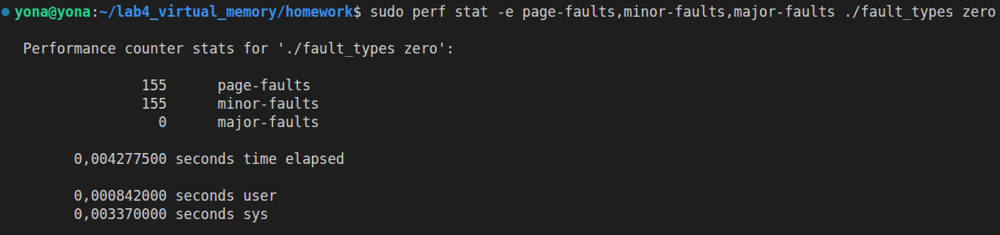

При первой попытке записи в анонимный регистр `mmap` процессор сгенерировал исключение сбоя страницы. Ядро Linux успешно перехватило его, выделило обнулённый физический кадр из RAM и возобновило инструкцию. Всего зафиксировано 155 minor-faults (базовое окружение процесса + страница аллокатора).

#### 2. Копирование при записи (Copy-on-Write)
Запуск сценария производился командой `sudo perf stat -e page-faults,minor-faults,major-faults ./fault_types cow`.
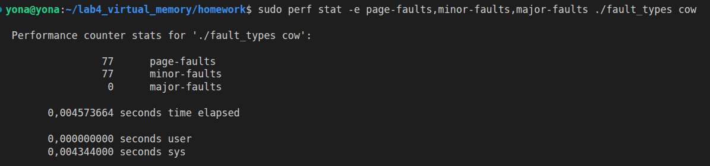
В данном сценарии счётчик зафиксировал 77 фаултов. Меньшее количество относительно анонимной аллокации обусловлено тем, что утилита `perf` агрегирует метрики основного родительского процесса. Непосредственный COW-fault с дублированием физического фрейма произошёл в контексте изолированного дочернего процесса (внутри ветки `fork() == 0`), защищённая PTE которого была аппаратно скопирована в режиме Read-Only.

#### 3. Отображение файла на диске (File-Backed)
Запуск сценария производился командой `sudo perf stat -e page-faults,minor-faults,major-faults ./fault_types file`.
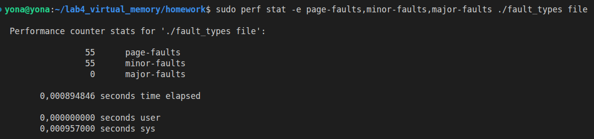

**Анализ результатов:**
Счётчик зафиксировал 55 page-faults и 0 major-faults. Минимальное количество сбоев и отсутствие дискового ввода-вывода (major-faults = 0) экспериментально доказывает эффективную работу подсистемы Page Cache в Linux. Поскольку файл `testfile.bin` уже создавался и перезаписывался в рамках сессии, его блоки находились в оперативной памяти ядра. При вызове маппинга и последующем чтении процессору не пришлось блокировать поток для медленного I/O-обмена с диском — ядро разрешило сбой как minor fault, связав виртуальный адрес процесса с уже существующим фреймом дискового кэша.

## Часть 4. Ответы на контрольные вопросы

### 1. В какой момент выделяется физическая память при вызове mmap(MAP_ANONYMOUS)? Опишите поведение метрики VmRSS.
В Линуксе память выделяется только при обращении к ней. Сделано это для её экономии (а что если программа никогда не обратится к этому участку памяти? Зачем лишний раз отдавать кусок памяти просто так?)


### 2. В чем разница между minor page fault и major page fault? Какое аппаратное или системное событие является узким местом для каждого из них?
Второе больше по времени, так как нам приходится ждать считывания (I/O) с другого диска, а не напрямую с RAM (страницы-то нет тут). Узкое место – считывание (особенно если низкая скорость считывания) с иного источника, например из swap-области.

### 3. Почему при использовании механизма Copy-on-Write (COW) после вызова fork() операция чтения из памяти выполняется без сбоев (page fault), а операция записи провоцирует исключение?
Потому что сразу после fork() память родительского процесса не копируется побайтово; хоть и создаётся две PTE, но указывают на один и тот же фрейм F. В то же время present = 1, а вот write = 0, поэтому только после попытки записи в процесс, они разделяются, выделяется реально новый физический фрейм для дочернего.

### 4. Что произойдет, если два независимых процесса отобразят один и тот же файл на диске с помощью mmap и начнут его читать? Возникнет ли major page fault во втором процессе, если первый уже прочитал файл? Какую роль здесь играет Page Cache и чем он отличается от TLB?
Так как файл уже был прочитан первым процессом, его данные уже лежат в оперативной памяти (в Page Cache ядра). Когда второй процесс отобразит этот же файл и обратится к нему, дискового чтения не потребуется. Произойдёт Minor Page Fault . Ядро просто настроит PTE нового процесса на те же самые физические фреймы в RAM, где уже кэширован файл.

### 5. Опишите, какие изменения происходят на аппаратном и программном уровнях при разрешении demand-zero page fault. Какие конкретно биты (атрибуты) выставляются в записи таблицы страниц (PTE) после выделения физического фрейма?
Начинается всё с того, что мы запрашивает соответсвие VA свой PA. Работу начинает MMU с TLB. Если всё ок – то ок, но нас интересует TLB miss. Он может быть по разным причинам, которые рассмотрятся уже после page walk(по всем уровням PT). И вот если права не нарушены и страница в допустимом и не «сырой» памяти, то ядро спускается по каждому уровню многоуровневой иерархической таблицы пока не дойдет до PTE, еслли чего то не было – лениво выделяет. В зависимости от состояния PTE выбирает что делать далее, а именно:
 a.	Demand-zero. Запрос был, а записи не было (реально в VA space не создали). Тогда находим чистый блок памяти (фрейм), заполненный нулями, и записываем PFN (адрес его) в PTE с флагами present = 1 (существование) и write = 1 (разрешено записывать сюда)
 b.	File-Backed. Программа отобразила файл в памяти, но пытается прочесть незагруженный кусок. Тогда мы выделяем фрейм; делаем запрос к драйверу/файловой системе для считывания задонного блока по смещению offset; ждём пока загрузится-считается до конца; Записываем PFN в PTE
 c.	COW. После fork(),как мы знаем, память общая у родительского и дочернего процесса (и в PTE указывают на один фрейм), а у дочернего еще и право доступа на запись временно write = 0, а тут мы пытаемся записать ещё что-то. Система понимает, что это COW-fault и просто выделяет новый фрейм, побайтово копирует содержимое старой общей страницы. Теперь перезаписываем PTE пишущего процесса на новый фрейм и write = 1
 d.	Swap-in. Память была вытеснена из-за нехватки места у RAM, а в PTE теперь не PFN, а координаты в SWAP-разделе. Мы, опять же, выделяем новый фрейм, читаем страницу из swap-пространства на диске обратно в RAM, восстанавливаем структуру PTE

### 6. При вызове системного вызова execve() ядро Linux уничтожает старое адресное пространство процесса. Какие именно сегменты нового исполняемого файла (ELF) создают участки адресного пространства, связанные с файлом (file-backed mappings), а какие выделяются как анонимные?
6.	Разберем с самого начала, что происходит (опуская наличие fork()). Ядро проверяет, существует ли исполняемый файл, и имеет ли процесс права на его выполнение.  Ядро считывает начало файла и служебную информацию (точка входа, какие данные/сегменты нужны). Освобождает старую mm_struct, в том числе и heap со stack, VMA, отображения, PT. Далее создаются «наброски» VMA. И только когда процессор впервые попытается прочесть инструкцию по новому адресу (через код программы, константы только для чтения, инициализированные переменные), MMU увидит, что в PT ничего нет, генерит page fault и решает её, создавая новый фрейм. 